# Manual de Usuario · Sistema de Inventario y Punto de Venta

Guía práctica e ilustrada para dueños, encargados y cajeros de tienda de abarrotes.  
Este manual explica cómo usar cada pantalla, botón y herramienta del sistema tanto en la **computadora de caja** como en el **celular enlazado**, con lenguaje claro y paso a paso.

---

## Índice

1. [Introducción y Roles de Usuario](#1-introducción-y-roles-de-usuario)
2. [Apertura de la Aplicación y Configuración Inicial](#2-apertura-de-la-aplicación-y-configuración-inicial)
3. [Pantalla de Inicio y Barra Superior](#3-pantalla-de-inicio-y-barra-superior)
4. [Vincular el Celular con Móvil (QR) y Terminal Móvil](#4-vincular-el-celular-con-móvil-qr-y-terminal-móvil)
5. [Catálogo y Precios](#5-catálogo-y-precios)
6. [Punto de Venta, Caja y Libreta de Fiados](#6-punto-de-venta-caja-y-libreta-de-fiados)
7. [Recepción de Mercancía, Proveedores y Cuentas por Pagar](#7-recepción-de-mercancía-proveedores-y-cuentas-por-pagar)
8. [Caducidades y Cambio Físico con Proveedor](#8-caducidades-y-cambio-físico-con-proveedor)
9. [Mermas y Bajas de Mercancía](#9-mermas-y-bajas-de-mercancía)
10. [Auditoría de Pasillo (Conteo Ciego)](#10-auditoría-de-pasillo-conteo-ciego)
11. [Reportes e Indicadores del Negocio](#11-reportes-e-indicadores-del-negocio)
12. [Respaldos Cifrados (.bak) y Copia Automática a USB](#12-respaldos-cifrados-bak-y-copia-automática-a-usb)
13. [Ajustes, Usuarios, Privacidad y Bitácora](#13-ajustes-usuarios-privacidad-y-bitácora)
14. [Licencia y Vigencia del Sistema](#14-licencia-y-vigencia-del-sistema)
15. [Preguntas Frecuentes y Solución de Problemas](#15-preguntas-frecuentes-y-solución-de-problemas)

---

## 1. Introducción y Roles de Usuario

El sistema funciona **100% dentro de tu tienda**, sin depender de internet para vender, escanear productos con el celular, leer notas de proveedor o guardar respaldos.

Al abrir la aplicación en tu computadora todo arranca automáticamente en segundo plano: solo necesitas dar clic en su icono e ingresar tu PIN. Toda la información de ventas, inventario, fiados y precios queda protegida bajo llave con tu **PIN de Administrador**, y cada movimiento importante queda anotado en un historial que no se puede borrar ni alterar.

### ¿Qué puede hacer cada rol en la tienda?

Para cuidar el dinero de la caja y la mercancía del negocio, el sistema maneja tres roles de acceso:

| Operación / Módulo | Cajero | Encargado | Administrador |
| :--- | :---: | :---: | :---: |
| Vender en Punto de Venta (POS) | Permitido | Permitido | Permitido |
| Cobrar efectivo / transferencia | Permitido | Permitido | Permitido |
| Abonar a cuenta de fiado | Permitido | Permitido | Permitido |
| Consultar Catálogo e imprimir hoja de códigos | Permitido | Permitido | Permitido |
| Alta/aprobación de productos y baja en Catálogo | Restringido | Permitido | Permitido |
| Modificar precios en Catálogo | Restringido | Restringido | Permitido |
| Recepción de mercancía y facturas | Restringido | Permitido | Permitido |
| Revisión de mermas y bajas | Restringido | Permitido | Permitido |
| Auditoría física de pasillo | Restringido | Permitido | Permitido |
| Cortes de turno y arqueos | Restringido | Permitido | Permitido |
| Reportes e indicadores del negocio | Restringido | Permitido | Permitido |
| Ajustes del negocio y parámetros | Restringido | Restringido | Permitido |
| Gestión de usuarios, permisos y cambio de PIN | Restringido | Restringido | Permitido |
| Respaldos cifrados (`.bak`) y restauración | Restringido | Restringido | Permitido |

---

## 2. Apertura de la Aplicación y Configuración Inicial

### 2.1 Cómo abrir la aplicación en la tienda

1. Enciende la computadora principal de la tienda y abre la aplicación desde su icono en el Escritorio o Menú Inicio.
2. Si la abres por primera vez, el sistema se inicia automáticamente y muestra en pantalla la bienvenida para crear tu clave de seguridad.
3. Mantén abierta esa ventana mientras atiendes en mostrador para que también pueda recibir los envíos de tu celular enlazado.

### 2.2 Primer día: crear el PIN de Administrador

La primera vez que entras aparece la pantalla **"Crea el PIN del administrador"**:

1. Escribe un **PIN numérico** de al menos 6 dígitos (**se recomienda 8 o más dígitos**) que no sea fácil de adivinar (evita secuencias como `123456` o números repetidos como `111111`).
2. Repite el PIN en el segundo recuadro y presiona **Crear PIN y cifrar**.
3. Anota este PIN en un lugar seguro donde solo el dueño tenga acceso.

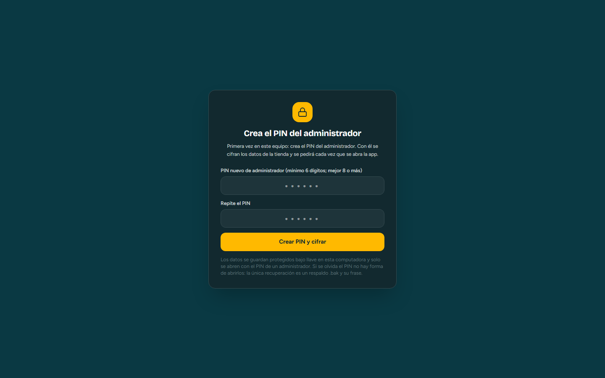

### 2.3 Inicio diario y cambio rápido de usuario

- **Al abrir la tienda cada día:** aparecerá la pantalla **"Datos de la tienda cifrados"**. Escribe el PIN de un Administrador y toca **Abrir datos**.
- **Cambiar de empleado en mostrador:** toca el botón **Bloquear** en la esquina superior derecha. Aparecerá la ventana **Terminal Bloqueada** para elegir el **Usuario** de la lista, escribir su **PIN de Acceso** (con opción de **Mostrar PIN** si necesitas verificar lo que tecleas) y tocar **Desbloquear**.
- **Si un usuario falla su PIN 3 veces seguidas**, queda bloqueado temporalmente por seguridad.

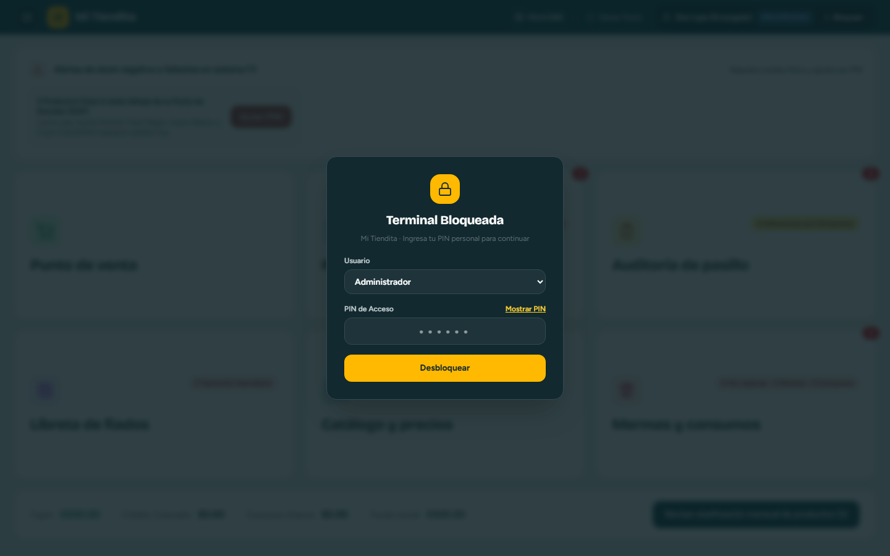

### 2.4 ¿Olvidaste el PIN de Administrador?

Si se olvida el PIN principal no existe una contraseña maestra oculta; la recuperación se hace con un archivo de respaldo:

1. En la pantalla inicial **"Datos de la tienda cifrados"**, toca **`¿Olvidaste el PIN? Recuperar desde un respaldo (.bak)`**.
2. Elige el archivo `.bak` desde tu memoria USB o computadora (o selecciona uno guardado en la lista local).
3. Escribe la **Frase de respaldo** con la que se protegió ese archivo y presiona **Verificar respaldo**.
4. Elige al administrador, define un **PIN nuevo**, repítelo y confirma. Los datos regresarán exactamente al momento en que se tomó ese respaldo.

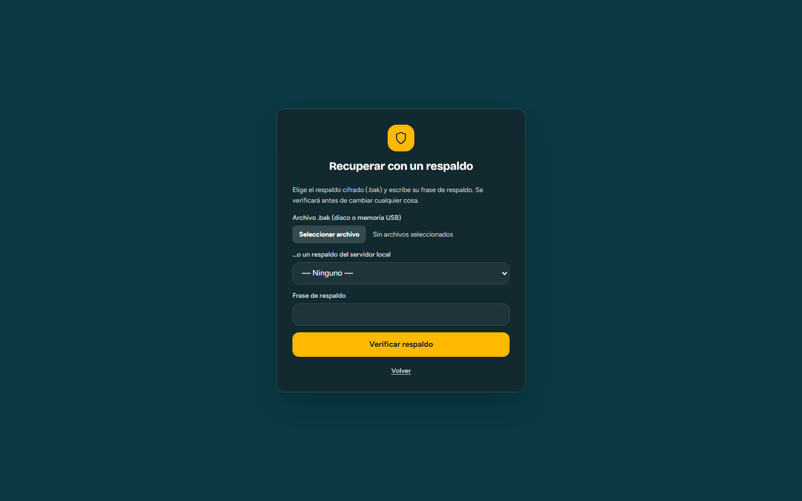

---

## 3. Pantalla de Inicio y Barra Superior

### 3.1 Barra superior y Tablero principal

En la barra superior siempre tendrás visibles los controles globales:
- **Botón Menú (`≡`):** despliega la navegación completa de la tienda.
- **Botón `Móvil (QR)`:** muestra el código QR para enlazar celulares (cuando ya hay uno conectado cambia a verde y dice **Móvil Conectado**).
- **Botón `Cerrar Turno`:** visible para Encargado y Administrador; abre el corte de caja rápido desde cualquier pantalla.
- **Panel de usuario:** muestra el nombre activo, su rol (`ADMINISTRADOR`, `ENCARGADO` o `CAJERO`) y el botón **Bloquear**.

En el centro de **Inicio** están las **6 tarjetas de operación diaria**:

1. **Punto de venta:** cobro en mostrador, granel, ventas en efectivo y fiado.
2. **Recepción de mercancía:** ingreso de notas de compra (foto por celular o manual), proveedores y pagos pendientes. Muestra avisos en rojo si hay productos con margen de ganancia caído.
3. **Auditoría de pasillo:** revisión de conteos ciegos hechos con el celular.
4. **Libreta de fiados:** acceso directo a las cuentas de crédito de vecinos, saldos vencidos y abonos.
5. **Catálogo y precios:** alta, edición, códigos de barras, existencias y precios por volumen.
6. **Mermas y consumos:** revisión de bajas con foto y acceso directo a caducidades próximas (`Por caducar`).

Debajo verás el **Resumen de Caja** en vivo (**Cajón**, **Crédito Colocado**, **Consumo Interno**, **Fondo Inicial**) y, cuando corresponda revisión mensual, el botón **Revisar clasificación mensual de productos**. Encima de las tarjetas también aparecen avisos automáticos cuando detecta stock negativo, pagos a proveedores por vencer o alzas de costo.

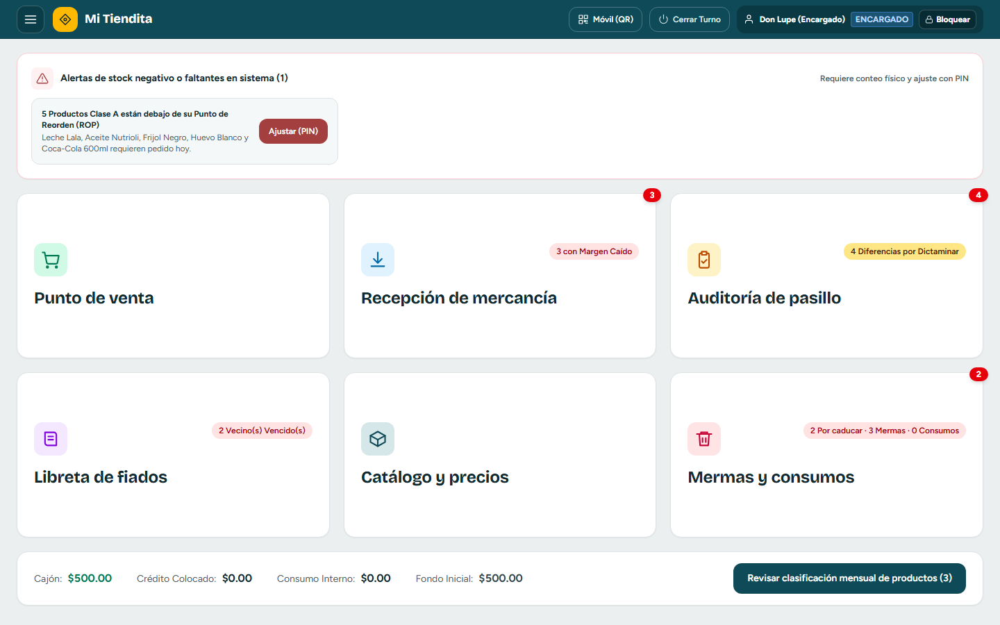

### 3.2 Menú lateral desplegable (`≡`)

Al tocar el botón **`≡`** arriba a la izquierda se abre el menú lateral con acceso a:
- **Inicio**
- **Reportes e indicadores** (con candado para Cajero)
- **Ajustes y usuarios** (solo Administrador)
- **Licencia**
- **`Respaldar ahora`** (para Encargado y Administrador, junto con avisos del estado de respaldos o USB)

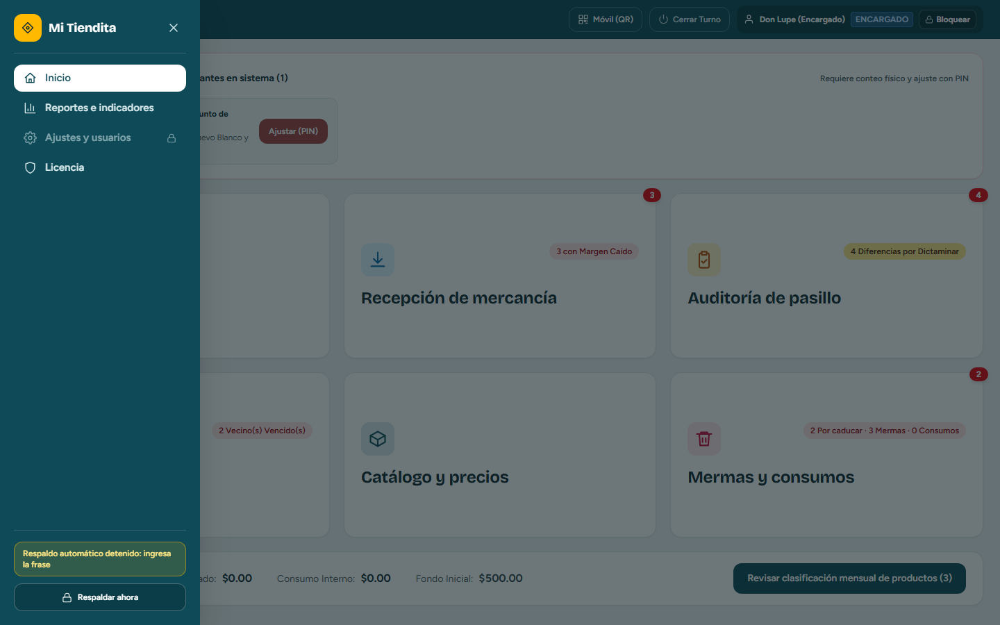

### 3.3 Botones de ayuda `?`

En campos que pueden generar dudas verás un pequeño círculo **`?`**:
- Pasa el cursor encima o tócalo en pantalla táctil para abrir una ventana breve que explica **qué significa el campo y para qué sirve** (por ejemplo, *Avisar para surtir*, *Reserva mínima*, *Merma normal por pesaje*, *IEPS*, *Clave corta del producto* y *Derechos ARCO*).

---

## 4. Vincular el Celular con Móvil (QR) y Terminal Móvil

El celular de la tienda o del encargado sirve como **escáner láser inalámbrico**, **cámara para leer notas de proveedor** y **herramienta de conteo en pasillo**, sin instalar aplicaciones externas.

### 4.1 Paso a paso para vincular el celular

1. Conecta el celular al **mismo Wi-Fi** que la computadora (no importa si ese Wi-Fi no tiene internet).
2. En la computadora, haz clic en **`Móvil (QR)`** en la barra superior.
3. Si la computadora tiene más de una red activa (por ejemplo cable Ethernet y Wi-Fi), usa el selector **`¿Qué red usa tu celular?`** para elegir la red Wi-Fi correcta.
4. Abre la cámara de tu celular y apunta al **código QR**. Toca el enlace que aparece en pantalla.
5. **La primera vez**, el navegador del celular mostrará una advertencia de seguridad: toca **Avanzado** y luego **Continuar** (es seguro, porque el enlace ocurre directamente dentro de tu tienda).
6. En la ventana de la computadora cambiará de *Esperando celular…* a verde: **`1 celular enlazado en vivo`**. La vinculación dura 30 días sin tener que escanear cada mañana.

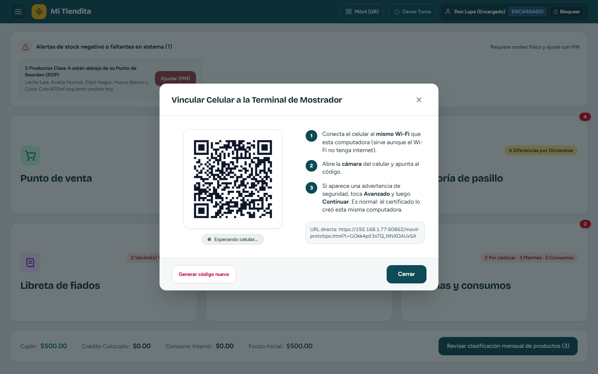

### 4.2 ¿Cómo desvincular celulares?

Si un empleado deja de usar su teléfono o cambiaste de equipo:
1. Abre **`Móvil (QR)`** en la barra superior de la computadora.
2. Toca **`Generar código nuevo`** y presiona **Confirmar**. Todos los celulares anteriores perderán acceso de inmediato.

### 4.3 Las 4 herramientas de la Terminal Móvil

Al abrir el enlace en el celular verás la barra superior con el estado verde **Enlazado con la PC**, un botón de sonido/vibración (para activar o silenciar el pitido al escanear) y 4 tarjetas de trabajo:

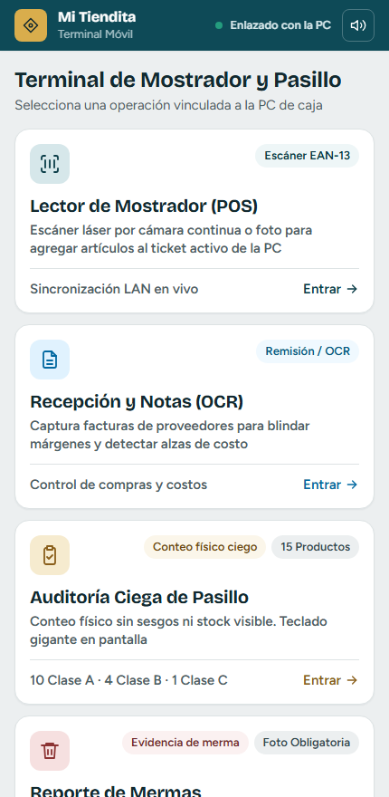

1. **Lector de Mostrador (POS):**
   - Toca **Iniciar Cámara** para escanear códigos de barras en vivo, o **Subir Foto** para leer el código desde una fotografía.
   - Cada lectura suena, vibra y manda el producto directo al ticket abierto en la computadora.
   - Si escaneas un producto que todavía no existe en tu catálogo, aparece la tarjeta **Código no registrado en catálogo** con el botón **Crear producto** (pide nombre, precio, costo y unidad). Ese producto se envía como *pendiente de aprobación* hasta que un Encargado o Administrador lo apruebe con su PIN en Catálogo.

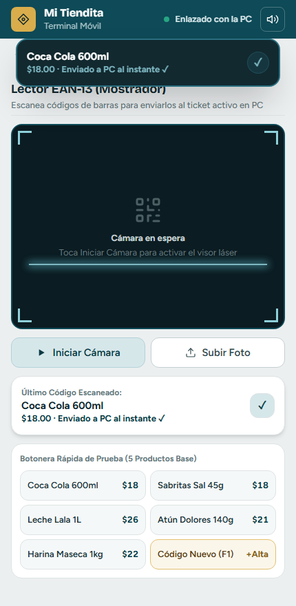

2. **Recepción y Notas (OCR):**
   - Toca **Tomar Foto a la Nota / Factura Física**, enfoca bien la nota de compra y espera a que reconozca el texto en español.
   - Revisa la lista de productos detectados (cantidades, costos y si cayó el margen) y toca **Mandar a Recepción de PC**.

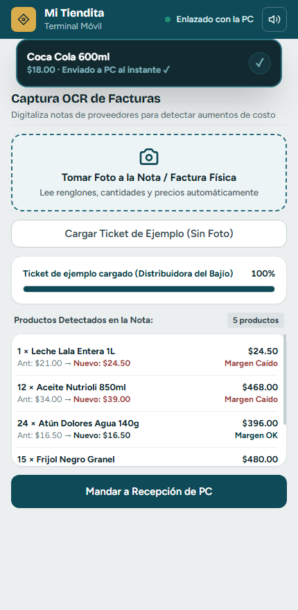

3. **Auditoría Ciega de Pasillo:**
   - Muestra producto por producto (ubicación, nombre, clave y unidad) **sin mostrar cuántas piezas dice la computadora** para que el conteo físico sea real y sin sesgos.
   - Escribe la cantidad contada usando el teclado numérico gigante en pantalla y toca **Guardar y Siguiente** (o **Omitir** si no pudiste contarlo en ese momento).
   - Al completar los productos, revisa el resumen y toca **Enviar Conteo a la Computadora**.

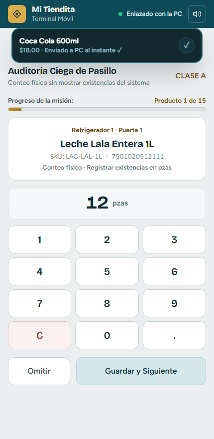

4. **Reporte de Mermas:**
   - Selecciona el motivo (**Empaque Roto**, **Caducado** o **Daño Manejo**).
   - Elige el **Producto Dañado** y ajusta las **Unidades a Dar de Baja** (`−` / `+`).
   - Toca **Tomar Foto** (la evidencia fotográfica es obligatoria).
   - Presiona **Reportar Merma a la Computadora** para enviarla a revisión.

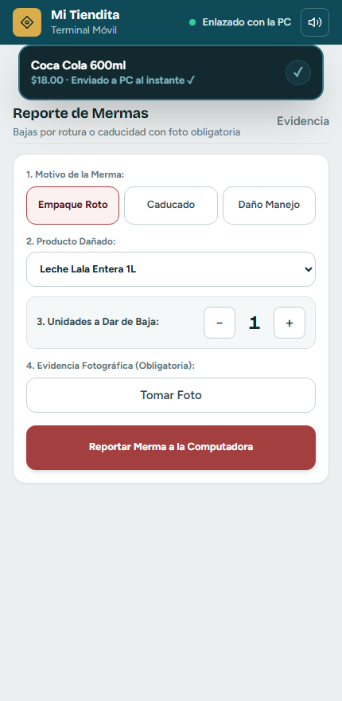

---

## 5. Catálogo y Precios

Disponible en la tarjeta **Catálogo y precios**. Todos los usuarios pueden consultarlo, pero solo **Encargado** y **Administrador** pueden crear, aprobar o desactivar productos, y solo el **Administrador** puede cambiar precios de venta en catálogo.

### 5.1 Explorar, filtrar y administrar productos

En la pantalla principal de **Catálogo y Precios** encuentras:
- **Filtros por importancia de ventas (`A`, `B` y `C`):**
  - **Clase A:** productos más vendidos que generan cerca del 80% de la ganancia.
  - **Clase B:** venta regular y complementarios.
  - **Clase C:** venta lenta o inventario detenido.
- **Buscador y categorías:** busca por nombre, clave corta, ubicación o código de barras, o filtra tocando una categoría. Marca **Mostrar productos desactivados** si necesitas recuperar un artículo dado de baja.
- **Acciones por producto:** **Editar**, **+ Cód. Propio** (si aún no tiene código de la tienda) y **Desactivar / Eliminar** (si el producto ya tuvo ventas o entradas se guarda como *Desactivado* con PIN para no alterar tu historial contable; después puedes usar **Reactivar**).

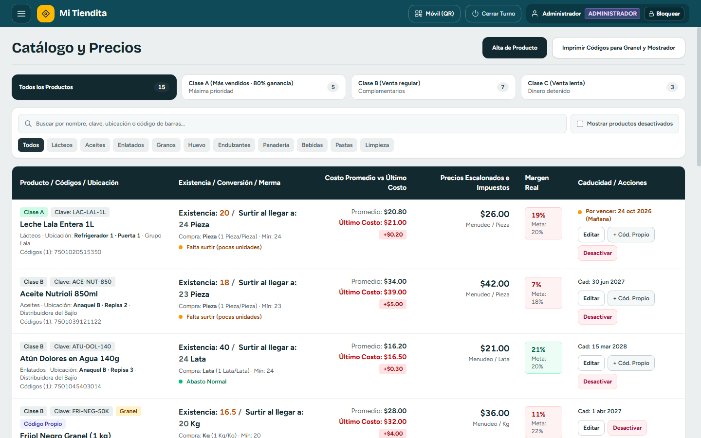

### 5.2 Alta de un producto nuevo (`Alta de Producto`)

Toca **`Alta de Producto`** para abrir la ventana **Alta de Nuevo Producto**:

1. **Identificación y ubicación:**
   - **Nombre del Producto (obligatorio):** nombre claro con presentación (ej. *Leche Lala Entera 1L*).
   - **Clave corta del producto:** se genera sola al escribir nombre y categoría; si quieres otra, edítala o usa **Autogenerar** (botón **`?`** explicativo).
   - **Categoría, Ubicación Física en Tienda y Proveedor:** al empezar a escribir sugiere opciones ya registradas en tu tienda para evitar duplicados.
2. **Unidades de Venta, Compra y Costos:**
   - **Unidad de Venta:** `Pieza`, `Kg`, `g`, `L`, etc.
   - **Unidad de Compra y Unidades por empaque:** si compras por caja o bulto y vendes por pieza, indica cuántas piezas trae el empaque (botón **`?`**).
   - **Costo por Empaque ($):** al escribir lo que cuesta la caja completa, calcula automáticamente el **Costo Unitario Venta ($)**.
   - **Precio Menudeo ($) (obligatorio)**, **IVA (%)**, **IEPS (%)** (botón **`?`** explica cuándo dejar en `0%`) y **Merma normal por pesaje (%)** (para granel, con botón **`?`**).
3. **Precios Escalonados por Volumen:**
   - Configura opcionalmente **Medio Mayoreo** y **Mayoreo** (cantidad mínima y precio unitario). En caja se aplican solos al llegar a esa cantidad.
4. **Códigos de Barras del Producto:**
   - Escanea o escribe uno o varios códigos de fábrica y presiona **Agregar Código** (evita duplicados automáticamente).
   - Si el producto es suelto o sin código de fábrica, toca **`Crear código propio de la tienda`** (o guarda sin código para generarlo automáticamente).
5. **Caducidad, Alertas y Existencia Inicial:**
   - **Fecha de Caducidad**, **Reserva mínima** (botón **`?`**), **Avisar para surtir** (te alerta en amarillo cuando toca pedir al proveedor; botón **`?`**) y la casilla **Venta a granel / báscula**.
   - **Existencia actual en tienda** y **PIN de encargado o administrador (obligatorio)**: si registras existencias iniciales mayores a `0`, escribe el PIN para autorizarlas.
6. Presiona **`Guardar Nuevo Producto`**.

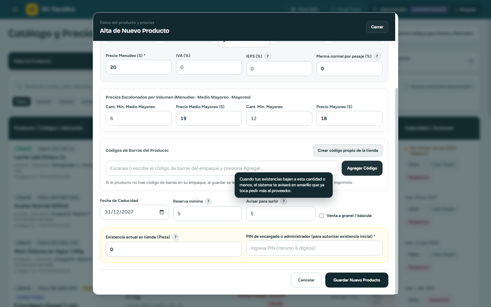

### 5.3 Productos creados desde el celular

Cuando un empleado da de alta un código desconocido desde el celular en mostrador, aparece arriba de la tabla en amarillo (**Productos Nuevos desde Móvil**):
- Nadie puede cobrarlo en caja hasta que un **Encargado o Administrador** presione **Aprobar (PIN)**, revise costo y precio, e ingrese su PIN (o presione **Rechazar**).

### 5.4 Hoja imprimible de códigos propios y granel

Toca **`Imprimir Códigos para Granel y Mostrador`** en la barra superior de Catálogo para abrir una hoja lista con los nombres, precios y códigos de barras de todos los artículos propios o a granel. Presiona **`Imprimir / Guardar en PDF`** para tenerla junto a la báscula o mostrador.

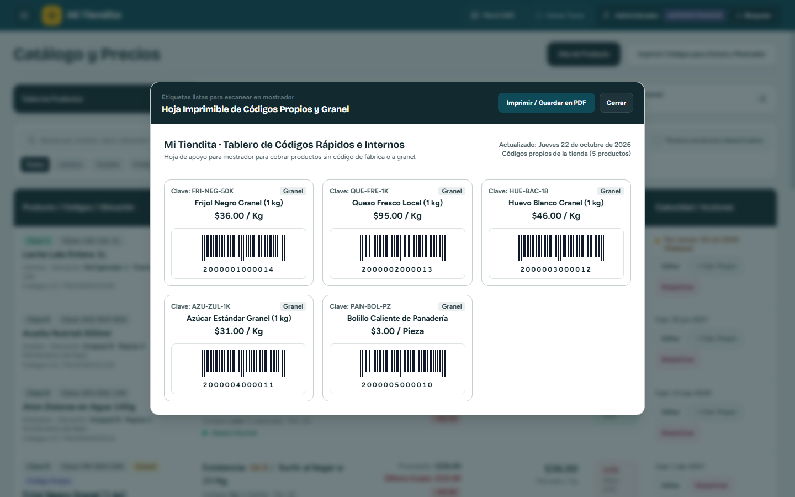

---

## 6. Punto de Venta, Caja y Libreta de Fiados

Disponible en la tarjeta **Punto de venta**.

### 6.1 Abrir y cerrar el turno de caja

- Si ves el aviso amarillo **"Turno de caja cerrado"**, las ventas están bloqueadas para proteger la contabilidad.
- Toca **Abrir Nuevo Turno** (o **`Corte / Turno`** arriba), escribe el **Fondo Inicial de Caja ($)** y autoriza con PIN de Encargado o Administrador.

### 6.2 Cobrar una venta en mostrador

1. **Agregar productos al `Ticket Actual`:**
   - Escanea con tu **lector USB** en el buscador superior, o con la cámara del **celular vinculado** (**Lector Móvil Activo**), o busca por nombre y presiona **Enter** o **`+ Agregar`**, o toca una tarjeta de **Acceso Rápido**.
2. **Despacho a granel (báscula):**
   - Al elegir un producto marcado como granel (botón **`Pesar`**) se abre la calculadora **Despacho de Granel** con dos pestañas:
     - **Por Monto en Dinero ($):** botones rápidos (`$15`, `$20`, `$25`, `$30`, `$50`, `$100`) o monto exacto. Indica cuántos gramos/kilos despachar en báscula.
     - **Por Peso en Báscula (Kg):** botones de `250 g (1/4 kg)`, `500 g (1/2 kg)`, `1.000 kg`, `1.500 kg` o lectura exacta de báscula.
   - Toca **`Agregar al Ticket ($...)`**.

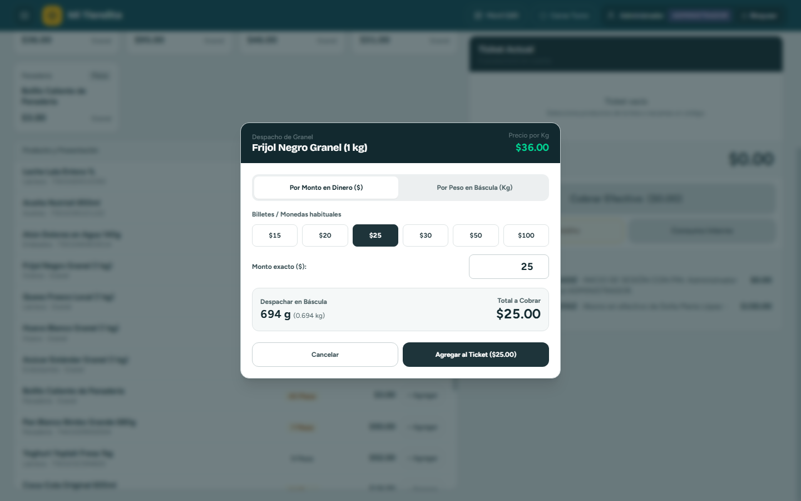

3. **Ajustar cantidades, niveles de precio y descuentos:**
   - En cada renglón del **Ticket Actual** puedes usar **`−`**, **`+`**, editar el número o **Quitar**.
   - Cambia el **Nivel** (*Menudeo*, *Medio Mayoreo*, *Mayoreo*) o aplica descuento por renglón (**Desc. Línea (%)**) o a todo el ticket (**Desc. Ticket (%)**).
   - Si el descuento supera el **Tope sin PIN**, el sistema avisará en amarillo y pedirá PIN de autorización al cobrar.

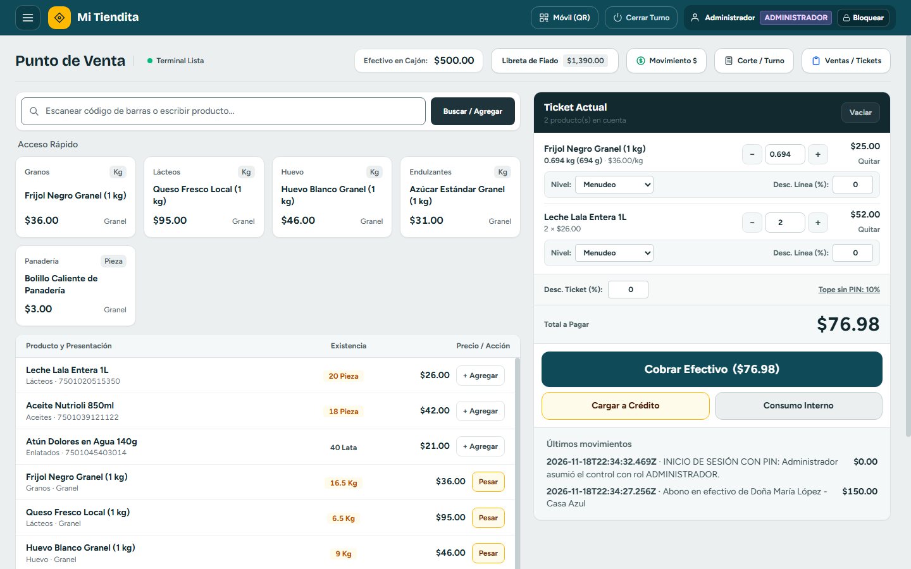

4. **Cobro en Efectivo:**
   - Toca el botón verde **`Cobrar Efectivo ($...)`**.
   - Elige el billete entregado (`$20`, `$50`, `$100`, `$200`, `$500`, `$1000`, **Exacto** u **Otro monto recibido**).
   - Verás en grande el **Cambio a Entregar** y toca **`Confirmar y Cobrar`**. Al terminar podrás imprimir el ticket térmico (58 mm u 80 mm).

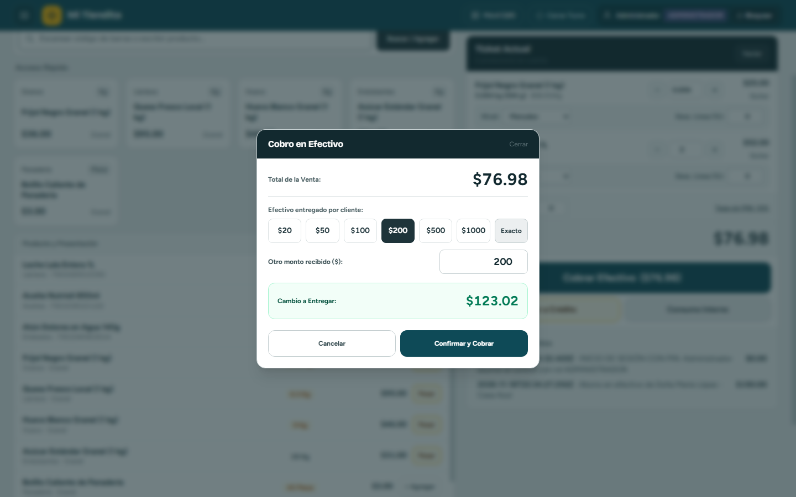

### 6.3 Libreta de Fiados (Crédito a Clientes)

Entra desde la tarjeta **Libreta de fiados** en Inicio, desde el botón **`Libreta de Fiado`** arriba en el POS o tocando **`Cargar a Crédito`** al cobrar:

- **Dar de alta a un cliente (`+ Nuevo Cliente`):** registra nombre, alias, teléfono, límite de crédito, plazo en días y si aceptó el **Aviso de Privacidad** (*De palabra, en el mostrador*, *Firmó en papel* u *Otro medio*).
- **Cargar una venta fiada:** selecciona al vecino; si tiene **saldo vencido** o **rebasa su límite de crédito**, el sistema bloquea automáticamente el nuevo cargo. Si está **Al Corriente**, toca **`Autorizar y Cargar`**. Las ventas fiadas no suman dinero al cajón hasta que se abonen.
- **Registrar Abono a Cuenta:** en la columna derecha elige al **Cliente que abona**, la **Forma de pago** (*Efectivo* suma al cajón; *Transferencia / SPEI* o *Tarjeta* no alteran el efectivo físico), el monto (`$100`, `$200`, `$500` u otro) y toca **`Registrar Abono`**.

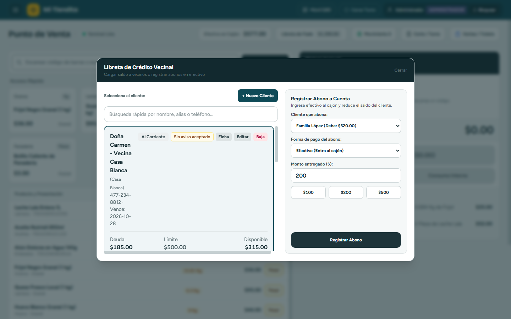

- **Ficha del cliente y Derechos ARCO (Privacidad):**
  - Toca **`Ficha`** en cualquier cliente para consultar su crédito disponible, historial de compras fiadas, historial de abonos y el panel **Privacidad y derechos ARCO** (con botón **`?`** explicativo):
    - **Acceso:** exportar sus datos en formato JSON.
    - **Rectificación:** corregir su nombre, alias, teléfono o notas.
    - **Oposición:** registrar que el cliente pidió no recibir avisos o recordatorios.
    - **Cancelación (anonimizar):** borra definitivamente sus datos personales manteniendo solo su saldo e historial contable (requiere **PIN de Administrador**).

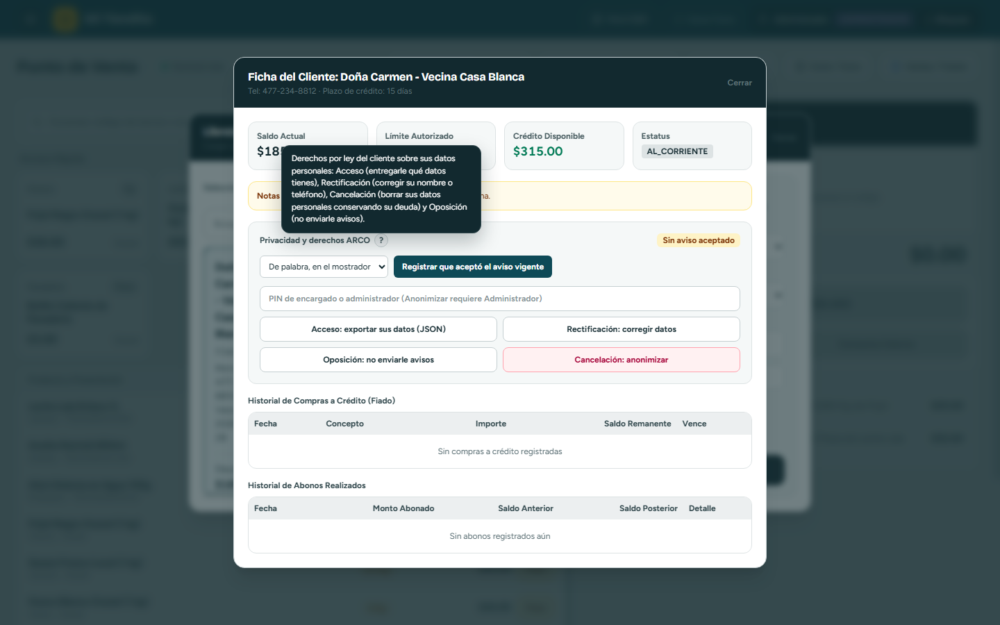

### 6.4 Consumo Interno

Cuando el dueño o un empleado toma productos para consumo del personal o uso propio de la tienda:
1. Agrega los artículos al Ticket Actual y presiona **`Consumo Interno`**.
2. Selecciona el **Responsable**.
3. Si la salida deja existencia negativa, captura PIN de Administrador y el motivo justificado.
4. Presiona **`Confirmar Consumo`**. Se descuenta del inventario al costo de compra sin sumar dinero al cajón.

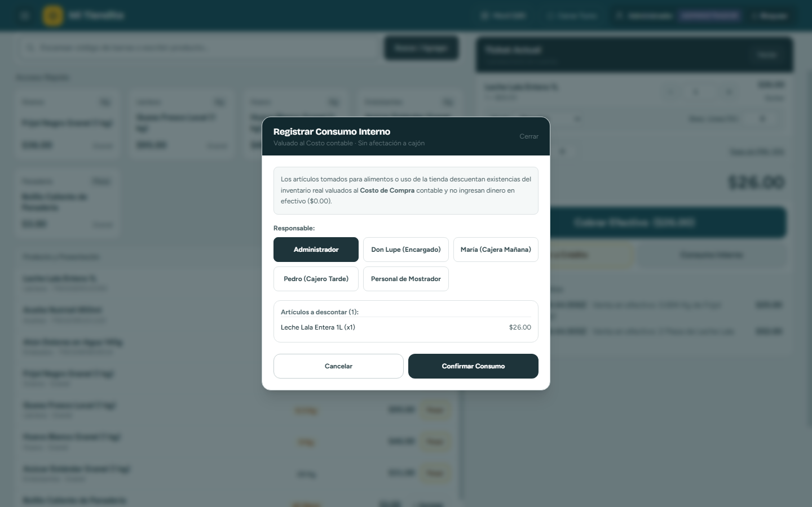

### 6.5 Entradas y salidas de efectivo (`Movimiento $`)

Para registrar dinero que entra o sale del cajón sin ser una venta (ingresar cambio, retiros parciales a caja fuerte, o gastos menores como garrafones):
1. Toca **`Movimiento $`** en la barra superior del POS.
2. Elige **`(+) Entrada`** o **`(-) Salida / Retiro`**.
3. Selecciona el **Motivo / Concepto**, escribe el **Monto en pesos ($)** y una nota opcional, y presiona **`Registrar Movimiento`**.

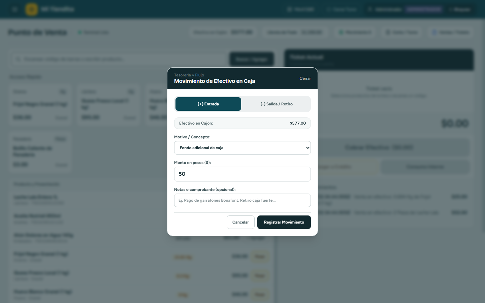

### 6.6 Historial de ventas, tickets y devoluciones (`Ventas / Tickets`)

1. Toca **`Ventas / Tickets`** arriba en el POS.
2. Filtra por **Todos**, **Efectivo** o **Fiado**, o busca por folio, cliente o cajero.
3. En cada ticket tienes dos botones:
   - **`Ticket`:** ver el comprobante e imprimirlo en formato 58 mm o 80 mm (las reimpresiones muestran el aviso de copia).
   - **`Devolver`:** permite devolver uno o varios artículos, o usar **Devolver Todo (Cancelar Venta)**:
     - Elige si el producto vuelve a **Stock vendible** o va directo a **Merma directa**.
     - En ventas fiadas cuyo reembolso excede la deuda actual, elige entre **Saldo a Favor** o **Reembolso en Efectivo**.
     - Ingresa motivo obligatorio y PIN de Encargado/Administrador.

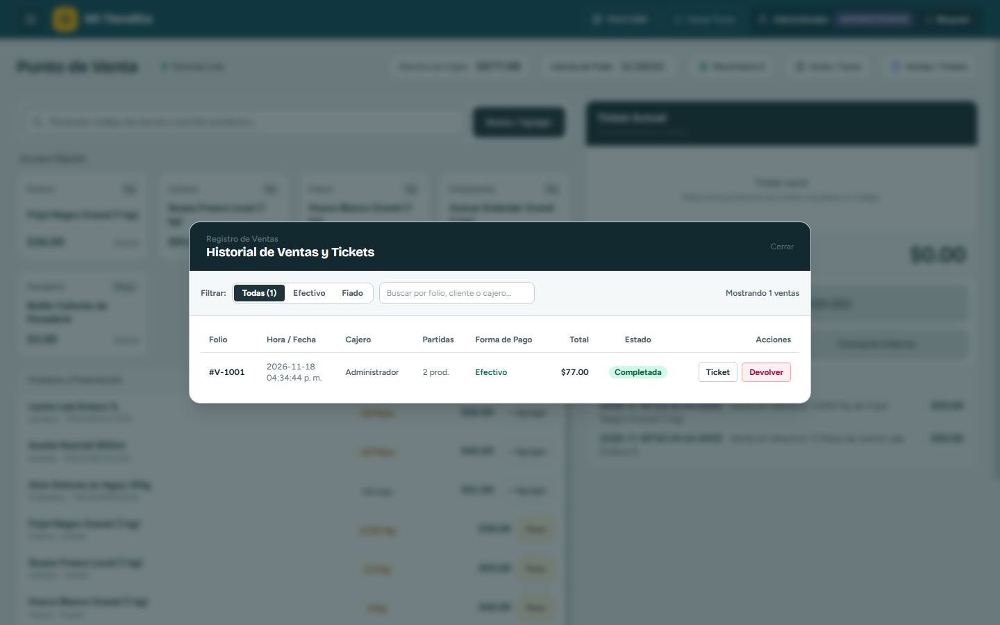

### 6.7 Corte de Caja y Cierre de Turno

Al terminar el turno o al cerrar la tienda:
1. Toca **`Corte / Turno`** (en el POS) o **`Cerrar Turno`** (en la barra superior).
2. Revisa el **Efectivo Teórico Esperado** (*Fondo Inicial + Ventas en Efectivo + Abonos + Entradas - Salidas*).
3. Cuenta el dinero físico en el cajón y captúralo en **Efectivo Físico Contado en Cajón ($)**.
4. El **Estado del Arqueo** mostrará si la caja está **Caja Cuadrada**, con **Sobrante** o con **Faltante**.
5. Cuando toque una vez por semana, responde opcionalmente la **Encuesta semanal de satisfacción (1 a 5)**.
6. Ingresa el **PIN Encargado / Admin (obligatorio)** (y tu frase de respaldo si es el primero de la sesión) para cerrar el turno y generar el respaldo cifrado.

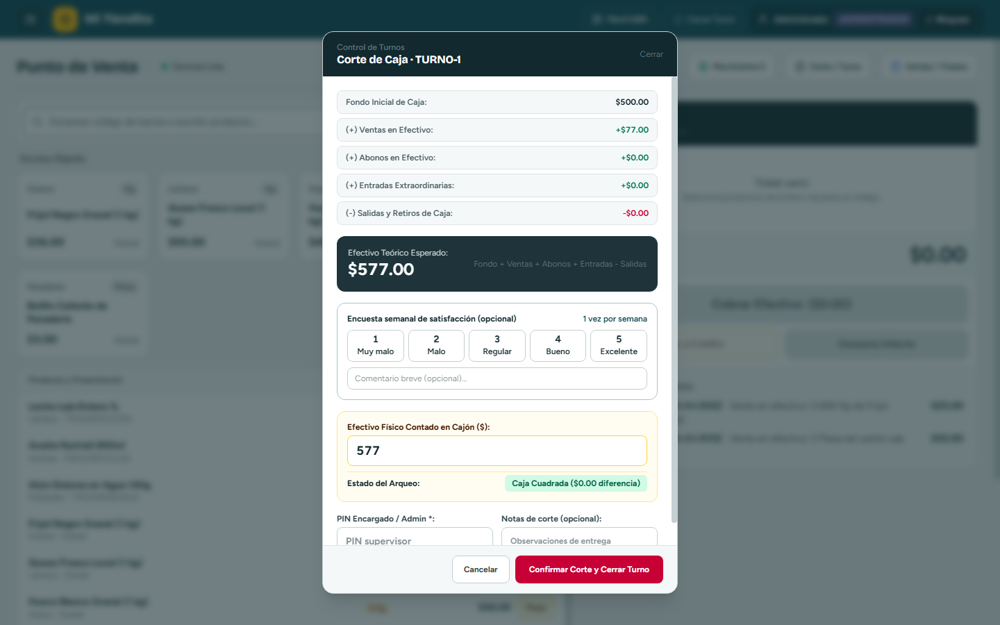

---

## 7. Recepción de Mercancía, Proveedores y Cuentas por Pagar

Disponible en la tarjeta **Recepción de mercancía**. Solo pueden entrar **Encargado** y **Administrador**.

### 7.1 Registrar notas de compra (`Recepción de Mercancía`)

Puedes trabajar de dos formas:
- **Nota Recibida por OCR (Celular / Foto):** muestra al instante la remisión fotografiada desde el celular con proveedor, folio y renglones.
- **Captura Manual de Factura / Nota:** elige el **Producto**, ajusta la **Cantidad** (en su unidad de compra), captura el costo y toca **`+ Agregar`**.
- Si llega un producto nuevo que no existe en tu catálogo, toca **`+ Alta Rápida de Producto`** para registrarlo sin salir de la nota.

#### Protección de Ganancia (Margen caído)

Cada línea compara el **Costo Anterior** contra el **Costo Nuevo**:
- Si un proveedor subió el precio y tu ganancia cayó por debajo de tu margen meta, el renglón se marca en rojo con **`Margen caído`** y **el guardado se pausa** para que no vendas perdiendo dinero.
- Toca **`Ajustar Precio a $...`** en cada alerta roja: el sistema aplica un precio redondeado comercialmente y cambia el estado a verde (**Precio protegido**).
- En la barra inferior elige **Proveedor**, selecciona **Pago** (**Contado** o **Crédito** con **Plazo** en días) y presiona **`Guardar Entrada en Inventario`**.

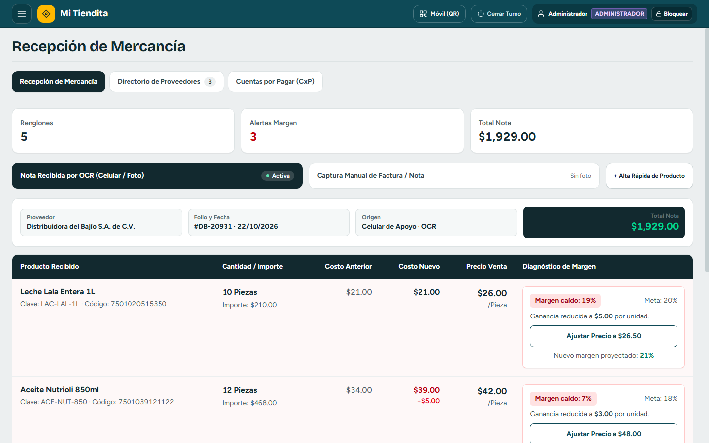

### 7.2 `Directorio de Proveedores`

En la segunda pestaña administras a tus proveedores:
- Usa **Nuevo Proveedor** o **Editar** para definir días de reparto, condición habitual (**Contado** o **Crédito**), plazo y si aceptan **cambio físico**.
- Toca **Ficha e Historial** para consultar el historial de alzas y cambios de costo de cada proveedor por producto.

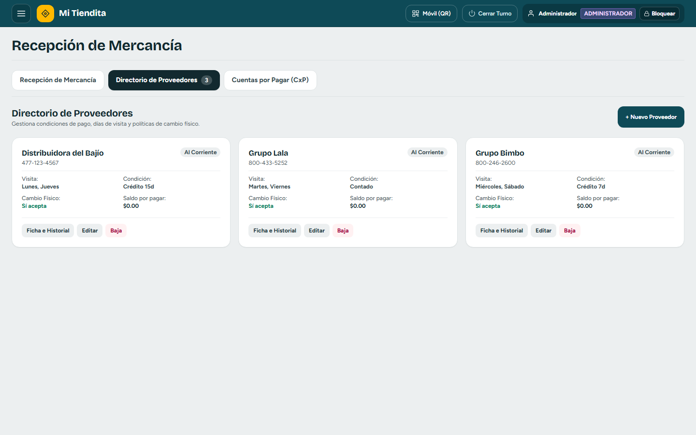

### 7.3 `Cuentas por Pagar (CxP)`

En la tercera pestaña monitoreas todas las facturas compradas a crédito, fechas de vencimiento y saldos pendientes:
- Toca **`Pagar Esta Nota`** (o **`Registrar Pago a Proveedor`**) para abonar o liquidar una factura.
- Elige el **Origen de los fondos**:
  - **`Cajón de la Tienda`:** descuenta el pago del efectivo disponible en caja (si excede el disponible pide PIN de encargado).
  - **`Bolsillo del Dueño (Fondo Externo)`:** amortiza la deuda al proveedor sin afectar el efectivo del cajón ni el corte de caja.
- Selecciona **Método de pago** (*Efectivo* o *Transferencia bancaria / Cheque*) y presiona **`Confirmar y Aplicar Pago`**.

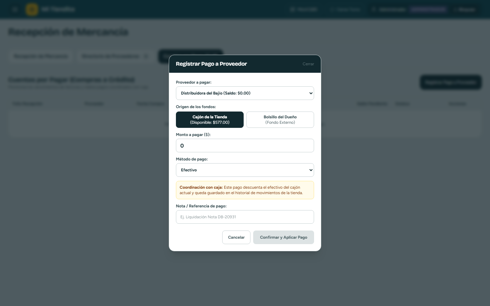

---

## 8. Caducidades y Cambio Físico con Proveedor

Disponible desde **Mermas y consumos → `Caducidades y Cambios con Proveedor`**.

1. **Agenda de Ruta — Proveedores en Ruta (Próximas 48 Horas):** muestra qué proveedores visitan la tienda hoy o llegan mañana (`Llega Mañana`), sus días de reparto, teléfono y si ofrecen cambio físico **Mano a Mano (Sin costo)**.
2. **Lotes que deben separarse del estante hoy:** lista los productos marcados **Vence en 48h** con la cantidad exacta **A Separar** para apartarlos antes de que llegue el repartidor.
3. Al atender al proveedor elige una opción:
   - **`Registrar Cambio Exitoso`:** selecciona la **Nueva caducidad** del producto fresco que te entregó el repartidor y confirma para renovar el lote sin pérdida.
   - **`Rechazado / Mandar a Merma`:** si no aceptó el cambio, envía el lote directo a la lista de mermas.

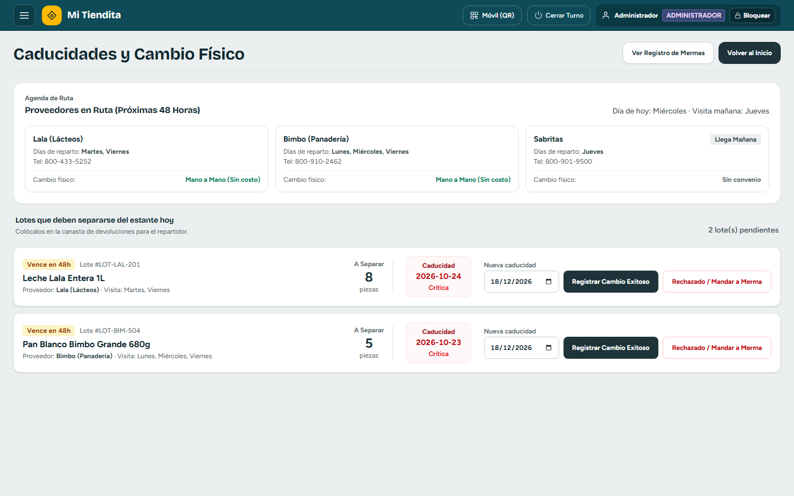

---

## 9. Mermas y Bajas de Mercancía

Disponible en la tarjeta **Mermas y consumos**.

- Arriba muestra 3 tarjetas resumen: **Pérdida Neta Semanal**, **Envase Roto en Piso** y **Caducado sin Devolución**.
- Cada reporte muestra su **evidencia fotográfica** (haz clic en la miniatura para ampliarla), la cantidad, el motivo, quién la registró y la **Pérdida al Costo**.
- Para aplicar la baja definitiva del inventario, un **Encargado o Administrador** debe tocar **`Confirmar Revisión`** (si la cantidad supera la existencia en sistema, pedirá PIN de Administrador y motivo justificado).

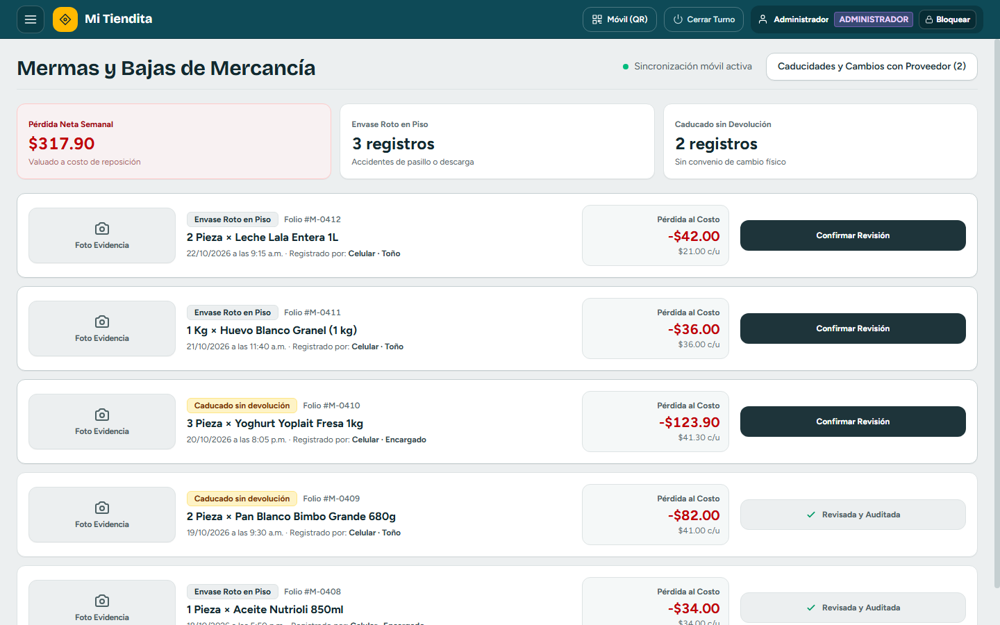

---

## 10. Auditoría de Pasillo (Conteo Ciego)

Disponible en la tarjeta **Auditoría de pasillo**. Sirve para descubrir faltantes reales, merma no registrada o productos mal cobrados mediante conteo físico sin sesgos.

1. Un encargado o empleado toma el celular enlazado, cuenta físicamente en el pasillo usando **Auditoría Ciega de Pasillo** (sin ver las existencias teóricas) y toca **Enviar Conteo a la Computadora**.
2. En la computadora aparecen los 4 totales (**Productos Contados**, **Cuadran Exacto**, **Faltante en Dinero** y **Sobrante en Dinero**) y la comparativa **En Sistema** vs **En Estante** producto por producto.
3. En productos a granel, si la variación está dentro del porcentaje configurado de **Merma natural**, el sistema la identifica como tolerancia normal de pesaje.
4. En cada producto con diferencia elige una acción:
   - **`Autorizar Merma Natural`** / **`Merma Normal Granel/Corte`**: ajusta el inventario al conteo físico como merma operativa.
   - **`Faltante Injustificado`**: ajusta el inventario dejando constancia del faltante.
   - **`Pedir Reconteo`**: reenvía el artículo al celular para verificarlo con una segunda cuenta física antes de ajustar. (Puedes usar **Deshacer** si te equivocaste).

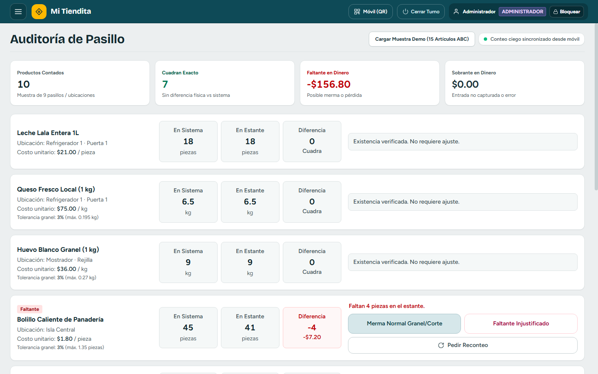

---

## 11. Reportes e Indicadores del Negocio

Disponible en el menú lateral (`≡`) → **Reportes e indicadores**. Accesible para **Encargado** y **Administrador**.

1. **Selecciona el periodo:** **Hoy**, **Semana**, **Mes** o **Rango** (*Desde* / *Hasta*).
2. **Tablero de los 8 Indicadores Operativos:**
   - **1. Ventas:** ingreso neto, bruto y devoluciones del periodo.
   - **2. Márgenes:** ganancia real promedio de lo vendido.
   - **3. Mermas:** costo total de mercancía dañada o caducada.
   - **4. Créditos vencidos:** saldo vencido en libreta de fiado.
   - **5. Diferencia stock-conteo:** variaciones detectadas en auditorías de pasillo.
   - **6. Tiempo por venta:** rapidez promedio de cobro en mostrador.
   - **7. Uso a los 30 días:** constancia de días con actividad registrada.
   - **8. Satisfacción:** promedio de las encuestas semanales (`Calificar` si está pendiente).
3. Haz clic en cualquier indicador o pestaña inferior (**Ventas**, **Márgenes**, **Mermas**, **Créditos vencidos**, **Stock vs. conteo**, **Tiempo por venta**, **Valor inventario**) para explorar su tabla detallada.
4. **Exportar o Imprimir:** usa **`CSV 8 Indicadores`** o **`Exportar [Pestaña] (CSV)`** para abrir los datos en Excel, o **`Imprimir reporte`** para imprimir o guardar en PDF.

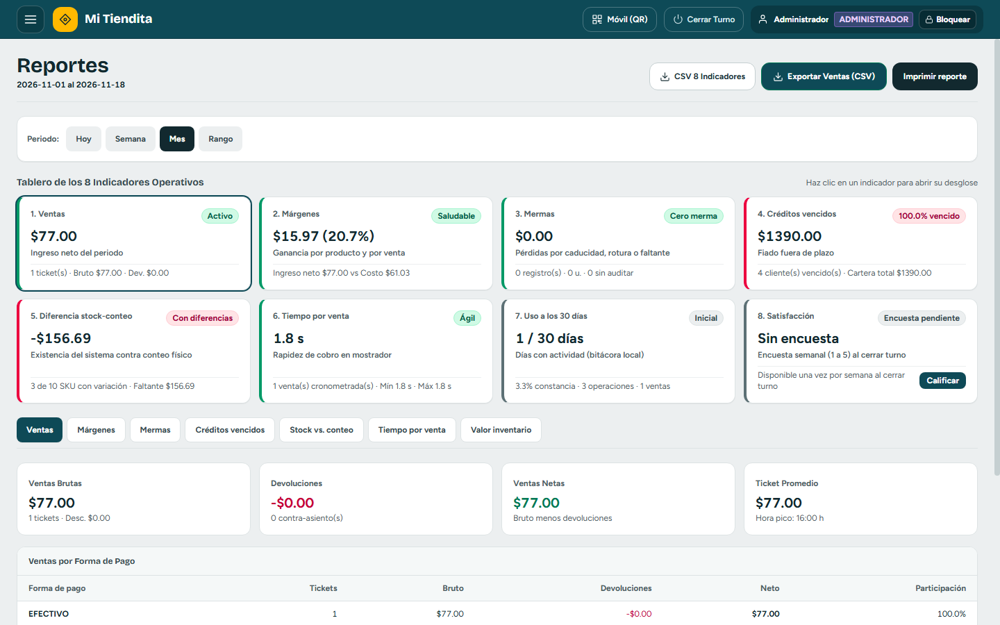

---

## 12. Respaldos Cifrados (.bak) y Copia Automática a USB

Toda la información de la tienda se guarda en archivos de respaldo `.bak` protegidos con contraseña para que, ante cualquier falla eléctrica o de equipo, no pierdas tu catálogo, fiados ni historial.

### 12.1 La Frase de Respaldo

- La primera vez que creas un respaldo o cierras caja en la sesión, el sistema pide escribir una **Frase de respaldo** de al menos 8 caracteres.
- **Muy importante:** por seguridad, **esa frase nunca se guarda en la computadora**. Anótala en un lugar seguro: **si se pierde o se olvida la frase, no es posible descifrar ni recuperar los archivos `.bak`**.

### 12.2 Respaldos manuales, automáticos y memoria USB

- **Automáticos:** se generan al cerrar cada turno y cada hora mientras operas el sistema si hubo cambios.
- **Manuales:** abre el menú lateral (`≡`) → **`Respaldar ahora`** (disponible para Encargado y Administrador). Se conservan hasta los **30 respaldos más recientes**.
- **Copia a USB:** si dejas conectada una memoria USB en la computadora, el sistema copia el respaldo más reciente del día automáticamente una vez al día dentro de la carpeta **`BinniTech-Respaldos`** de la memoria (verificando su integridad). También puedes pulsar **`Copiar a memoria USB (.bak)`** o **`USB`** en cualquier archivo de la lista.

### 12.3 Restaurar o pasar la tienda a otra computadora

En la misma ventana **Respaldo Cifrado del Servidor Local**:
- **Recuperar un respaldo guardado:** toca **Restaurar** en la fila correspondiente e ingresa la frase de respaldo (si acabas de restaurar y necesitas volver atrás, aparecerá **Deshacer restauración**).
- **Traer datos desde una USB u otra PC:** en la sección **Importar respaldo .bak desde disco o memoria USB (otra PC)**, selecciona el archivo `.bak`, escribe su frase y presiona **`Importar y restaurar .bak`**.

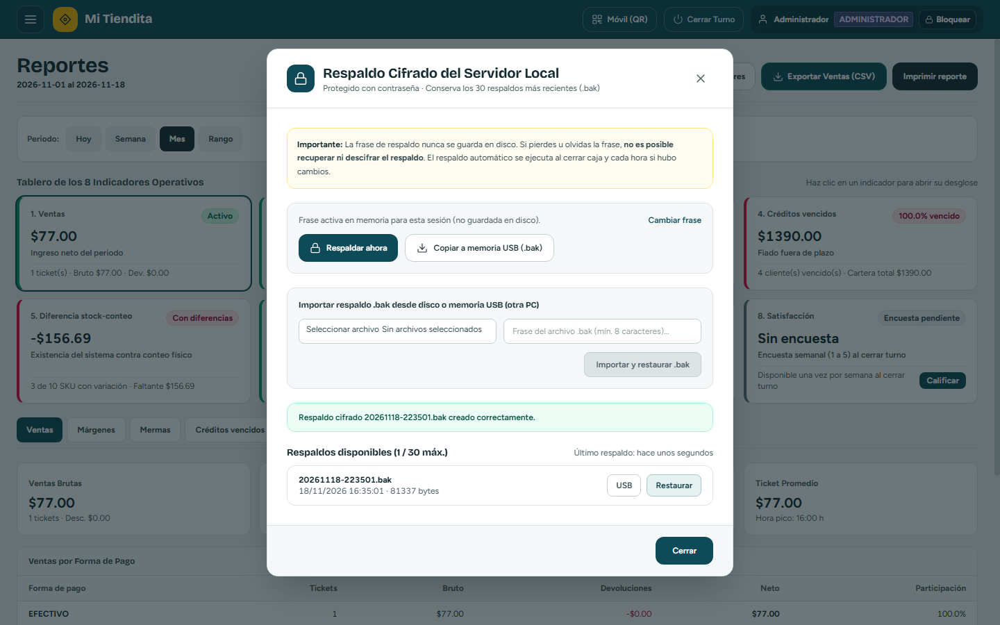

---

## 13. Ajustes, Usuarios, Privacidad y Bitácora

Disponible en el menú lateral (`≡`) → **Ajustes y usuarios**. Requiere autorización con **PIN de Administrador** y cuenta con **5 pestañas**:

### 13.1 `Parámetros del Negocio`

Configura **Nombre Comercial de la Tienda**, **Fondo Inicial de Caja**, **Umbral de Margen Mínimo (%)**, **IVA por Defecto (%)**, **IEPS por Defecto (%)**, **Tiempo de Bloqueo por Inactividad (Minutos)** (`0` para desactivar) y **Tope Máximo de Descuento sin Autorización PIN (%)**. Presiona **`Guardar Parámetros`**.

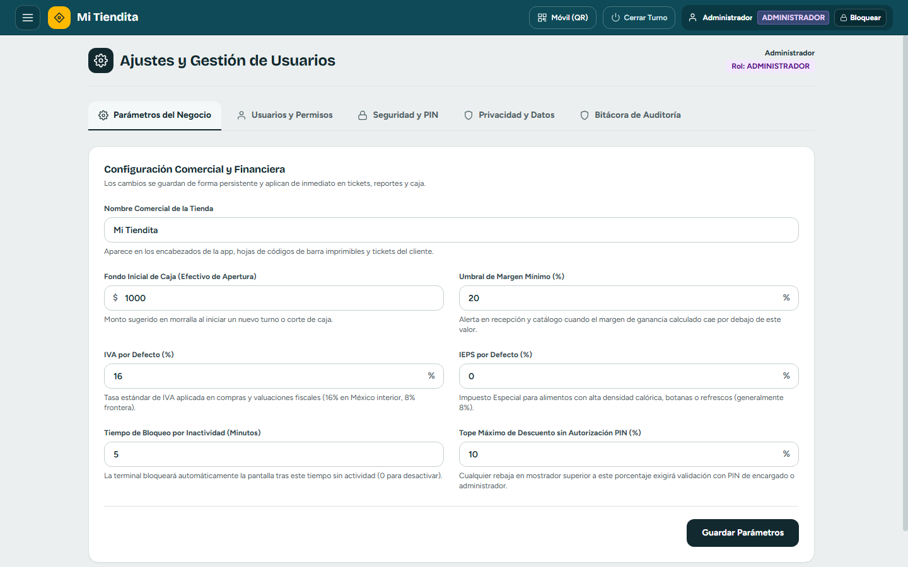

### 13.2 `Usuarios y Permisos`

Administra a todo tu personal:
- Crea cuentas nuevas con **`+ Alta de Usuario`** (nombre, rol `Cajero`, `Encargado` o `Administrador`, y PIN numérico de 6+ dígitos).
- Cambia el rol en la tabla o usa **Desactivar / Reactivar**.
- Debajo puedes consultar en todo momento la **Matriz Documentada de Permisos y Roles**.

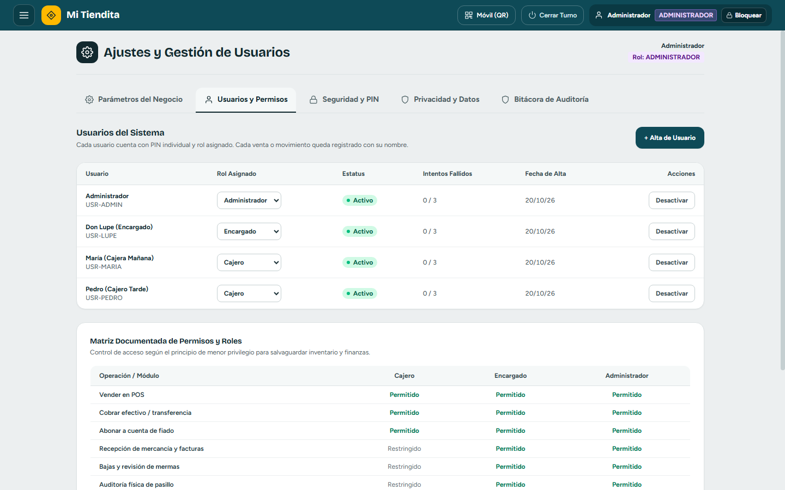

### 13.3 `Seguridad y PIN`

Permite cambiar tu propio PIN o restablecer el de cualquier empleado eligiendo al usuario en la lista, ingresando el PIN actual (o tu **PIN de Administrador** si restableces el de otra persona) y confirmando el nuevo PIN.

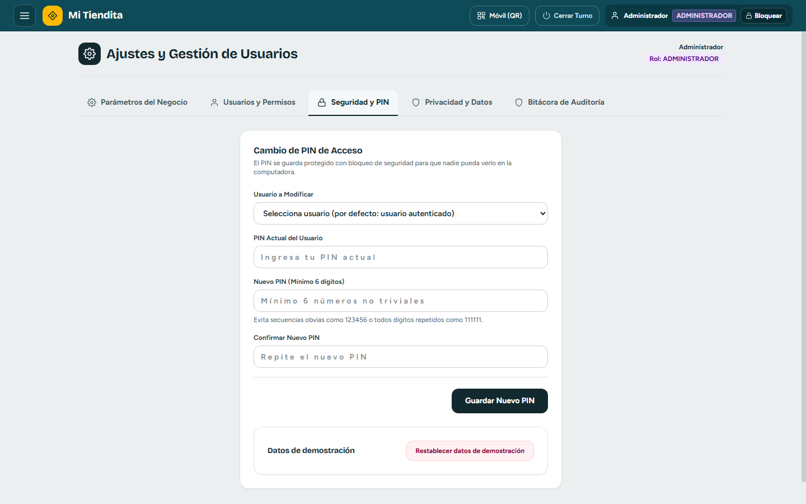

### 13.4 `Privacidad y Datos`

- Verifica que el bloque **Datos protegidos bajo llave en este equipo** esté activo y consulta la lista de **Clientes de crédito sin consentimiento vigente**.
- Edita el **Aviso de privacidad para clientes de crédito** (*Responsable de los datos*, *Contacto para solicitudes ARCO* y *Texto del aviso*) y toca **`Publicar nueva versión`** cuando necesites actualizarlo.

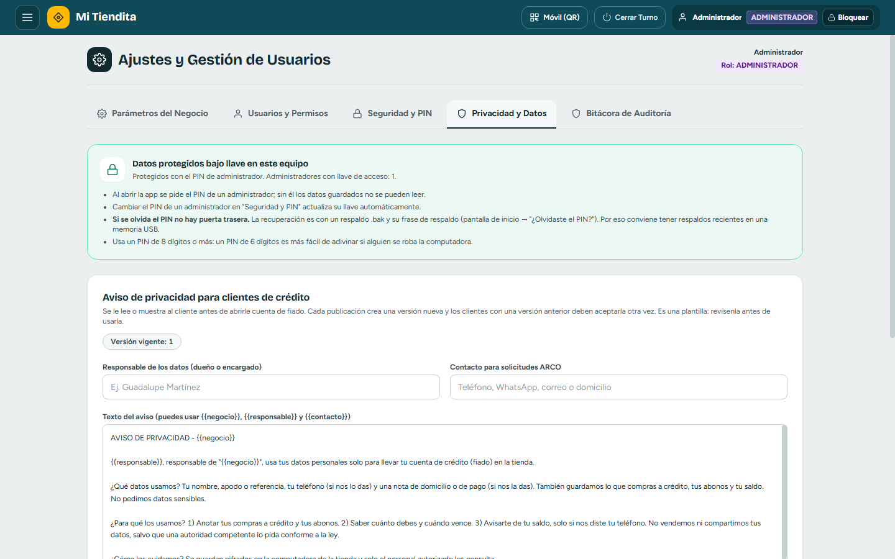

### 13.5 `Bitácora de Auditoría`

Muestra el estado de verificación del **Historial de Seguridad** (confirmando que está íntegro y sin alteraciones) y el listado cronológico de todas las acciones sensibles realizadas en la tienda con fecha, detalle, usuario responsable y sello de seguridad.

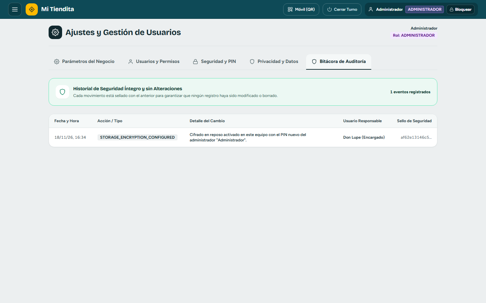

---

## 14. Licencia y Vigencia del Sistema

Disponible en el menú lateral (`≡`) → **Licencia**.

- **Tarjeta Estado de Licencia:** indica el plan contratado, fecha de emisión, fecha de vencimiento, días restantes y si el cobro está **Habilitado**. Si vence, otorga un **Periodo de gracia de 7 días**; pasado ese plazo entra en **Modo solo lectura** (se bloquea el cobro en caja, pero **siempre podrás exportar Reportes CSV y Respaldos `.bak`**).
- **ID Único de Instalación:** presiona **`Copiar ID para enviar por WhatsApp`** cuando necesites solicitar una renovación.
- **Integridad del Reloj:** revisa que la fecha de la computadora no se haya atrasado manualmente.
- **Renovar sin internet:** pega tu código corto (`BT1...`) en **Ingresar o Renovar Código de Licencia** y presiona **`Validar y Activar Licencia`**.

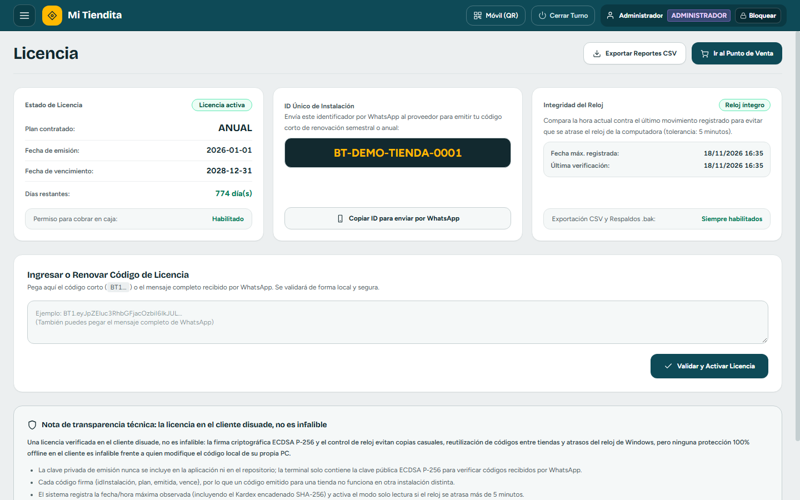

---

## 15. Preguntas Frecuentes y Solución de Problemas

### El celular no abre el código QR o no se enlaza con la PC
- Verifica que la computadora y el celular estén en **la misma red Wi-Fi**. (Si el módem del local bloquea la comunicación entre aparatos, activa la **Zona Wi-Fi / Compartir internet** del celular y conecta la PC a ella; no consume tus datos móviles al usar la tienda).
- En la PC, abre **`Móvil (QR)`** y prueba cambiar de red en el selector **`¿Qué red usa tu celular?`** si aparecen varias opciones.
- Si es la primera vez en ese celular y sale advertencia de seguridad, toca **Avanzado → Continuar**.
- Asegúrate de que la aplicación siga abierta en la computadora principal y de haber permitido el acceso en redes **Privadas** si Windows lo solicitó al instalar.

### La caja no me deja cobrar ("Turno de caja cerrado")
- Un Encargado o Administrador debe abrir el turno desde **`Corte / Turno` → `Abrir Nuevo Turno`**, ingresar el fondo inicial de efectivo y confirmar con su PIN.

### No me deja guardar una entrada de mercancía en Recepción
- Revisa si hay renglones en rojo marcados con **`Margen caído`**. El proveedor subió su precio de venta; toca **`Ajustar Precio a $...`** en esos renglones para desbloquear el botón **`Guardar Entrada en Inventario`**.

### No puedo vender un producto recién escaneado con el celular
- Por seguridad, los productos nuevos registrados rápidamente desde el celular quedan pendientes. Un Encargado o Administrador debe entrar a **Catálogo y precios** y presionar **`Aprobar (PIN)`** en la sección amarilla superior.

### Aparece el aviso "Esta app ya está abierta en otra ventana · Modo solo lectura"
- Para evitar cobros duplicados o daños al inventario, solo debes trabajar en **una ventana a la vez** en la computadora. Cierra la ventana repetida y actualiza la principal.

### ¿Qué pasa si se va la luz en la tienda?
- Cada venta, abono y recepción se guarda al instante en el almacenamiento interno de la computadora. Al regresar la luz, abre nuevamente la aplicación desde su icono e ingresa tu PIN. Además, conserva siempre una memoria USB conectada para contar con copia diaria automática en la carpeta **`BinniTech-Respaldos`**.
